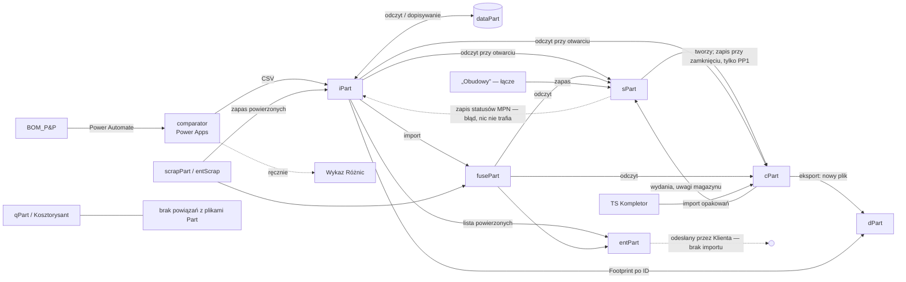

# Współzależności między plikami — synteza analizy technicznej

Data: 2026-11-23. Podstawa: analizy kodu VBA, formuł i comparatora w tym folderze oraz notatki z wywiadu [../wywiad-obieg-plikow.md](../wywiad-obieg-plikow.md). Najważniejsze ustalenia sprawdzono bezpośrednio w kodzie.

Oznaczenia: **[zgodne z wywiadem]**, **[różnica względem wywiadu]**, **[nowe]**, **[niepewne]**.

## 1. Mapa przepływów

Linia przerywana oznacza przepływ, który nie istnieje albo nie działa.

## 2. Wszystkie powiązania

| Od → Do | Kto inicjuje | Kiedy | Co przenosi | Uwagi |
|---|---|---|---|---|
| BOM_P&P → comparator | comparator (Power Automate) | Wczytanie | Tabele BOM i PP | [różnica] Comparator to Power Apps + Power Automate, nie Power BI |
| comparator → iPart | iPart (import CSV) | Import BOM | Rdzeń BOM, Confirmed, THT, znacznik komponentu Klienta (kolumna AF) | Kod eksportu comparatora nie został dostarczony |
| comparator → Wykaz Różnic → iPart | Człowiek | Ręcznie | Pytania i odpowiedzi | [zgodne z wywiadem] |
| dataPart → iPart | iPart | Kroki 1–5 (przyciski) | Value, Case, Footprint, Mounting, parametry | Dopasowanie po MPN z luźną normalizacją (usuwa `-` `_` `/`) |
| iPart → dataPart | iPart | Formularze, zatwierdzenie P&P | Nowe MPN, parametry, flagi, Tagi | [nowe] Zatwierdzenie P&P zatwierdza Footprinty całego BOM, także DNP i THT |
| scrapPart (entScrap) → iPart, fusePart | iPart, fusePart | Lista powierzonych | Zapas dla powierzanych | Próg wybierany „od góry” |
| iPart, fusePart → entPart | iPart, fusePart | Lista powierzonych | Plik do Klienta | Odesłany entPart nie ma importu — [zgodne z wywiadem] |
| iPart → fusePart | fusePart | Przycisk „Importuj pliki iPart” | Rdzeń BOM (bez Footprint), MPN zatwierdzone, komentarze, EntPart | [nowe] MPN niedozwolone nie są przenoszone; [niepewne] MPN1 może być pomijany (odczyt od kolumny P) |
| fusePart → iPart | — | — | — | Brak synchronizacji wstecznej — [zgodne z wywiadem] |
| iPart / fusePart → sPart | sPart | Otwarcie w trybie pracy, przycisk | Rdzeń BOM, EntPart (☑ → dostawca „Klient” automatycznie), MPN zatwierdzone, komentarze | Wymaga zatwierdzenia BOM w iPart (N1:N4) |
| iPart / fusePart → sPart (statusy) | sPart | Przy wpisaniu MPN / zamknięciu | Status MPN: zgodny, zatwierdzony, niedozwolony | Lista niedozwolonych nie jest widoczna, tylko status |
| sPart → iPart (zamienniki) | sPart | Każde zamknięcie | Zamiar: ręczny status → MPN zatwierdzone/niedozwolone + log | **Błąd: nic nie trafia** (porównanie małych liter z wielkimi), a plik iPart i tak jest zapisywany |
| „Obudowy” (łącze) → sPart | sPart (formuły) | Przeliczanie | Zapas wg obudowy | [różnica] Nie scrapPart wprost; próg wybierany „od dołu” |
| Magazyn CSV/XLSX → sPart | Zakupowiec | Ręczne wklejenie | Stany, kompletacje, ZD | Dopasowanie po PN wpisanym ręcznie w kolumnie AA; doliczany stan zablokowany |
| Cennik, lista opakowań zablokowanych → sPart | sPart (łącza) | Przeliczanie | Ceny magazynowe, ilości zablokowane | [nowe] |
| Plik wyceny → sPart | Zakupowiec | Przycisk WKLEJ | Ceny, dostawca, LT, zapas z wyceny | Stałe zakresy od wiersza 19 |
| Kursy NBP → sPart, qPart | Power Query | Przycisk ODŚWIEŻ | Kursy walut | Wymaga internetu |
| sPart → cPart | sPart | Przycisk; każde zamknięcie (gdy AP2 wypełnione) | Kolumny zakupowe bez cen, nagłówek ZK | **Tylko arkusz PP1**; pomijane bez komunikatu, gdy cPart jest otwarty |
| sPart tworzy cPart | Zakupowiec | Przycisk | Kopia wzorca | [zgodne z wywiadem] |
| cPart → sPart | sPart | Import BOM w sPart | „Wydano” i uwagi magazynu ze wszystkich PP | [nowe] Przepływ wsteczny, który działa |
| iPart / fusePart → cPart | cPart | Otwarcie w trybie pracy, przycisk | Rdzeń BOM, historia zmian, MPN zatwierdzone, komentarze | Wymaga zatwierdzenia BOM; wpisy magazynu zostają |
| TS Kompletor → cPart | Magazyn | „Importuj Numery Opakowań” | Opakowania, ilości, lokalizacje (dopasowanie po MPN) | [różnica] Import do cPart, nie dołączanie przy eksporcie dPart |
| cPart → dPart | cPart | Eksport | Nowy plik dPart, poprzedni do `z_NIEAKTUALNE` | [różnica] **Brak blokady bez zatwierdzenia P&P** |
| iPart / fusePart → dPart | cPart (przy eksporcie) | Eksport | Footprint po ID, podział desygnatorów na ZK | |
| dPart → inne pliki | — | — | — | Zmiana ilości w dPart nigdzie nie wraca |
| MASTER → iPart, sPart, cPart | Każdy plik | Otwarcie | Nowe makra (nie układ arkuszy) | fusePart nie ma tego mechanizmu |
| qPart ↔ pliki Part | — | — | — | [różnica] Brak powiązań; grupy obudów z własnych słowników po nazwie footprintu |

## 3. Wnioski z przekroju plików

### 3.1 Dane prawie zawsze „ciągnie” plik odbiorcy

- sPart i cPart same czytają iPart przy otwarciu, cPart sam tworzy dPart.
- Wyjątki:
  - sPart zapisuje do cPart, bo cPart nie może widzieć cen;
  - sPart zapisuje do iPart, ale ten przepływ nie działa;
  - iPart zapisuje do dataPart.

Każdy plik musi więc znać położenie i układ arkuszy plików, z których czyta. To główne źródło kruchości systemu.

### 3.2 Linie łączy numer pozycji

Wszystkie pliki dopasowują linie po ID lub numerze pozycji, a kolumny częściowo po nagłówkach. To potwierdza wniosek z wywiadu o stałej kolejności linii (wywiad, „Wnioski dla aplikacji”, punkt 3).

### 3.3 Jedyna twarda blokada to zatwierdzenie BOM w iPart

- Zatwierdzenie BOM (komórki N1:N4) sprawdzają sPart i cPart.
- Zatwierdzenia P&P przez Technologa nie sprawdza żaden plik poza iPart, choć według wywiadu powinno blokować zakończenie kompletacji.
- Linie niepotwierdzone (Confirmed) są w sPart tylko podświetlane.

### 3.4 Przepływy wsteczne są niepełne

| Przepływ | Stan |
|---|---|
| Zamienniki sPart → iPart | Kod istnieje, nie działa (błąd) |
| Decyzje fusePart → iPart | Brak |
| Wydania cPart → sPart | Działa |
| Zmiany ilości dPart → inne pliki | Brak |
| entPart od Klienta → sPart/cPart | Brak |

To potwierdza najważniejszy wniosek wywiadu: decyzje zapadają w różnych miejscach i nie wracają do jednego źródła.

### 3.5 Ta sama reguła w kilku miejscach, za każdym razem inaczej

| Reguła | Gdzie | Różnica |
|---|---|---|
| Value rezystora (PPM) | Krok 1 iPart, formularz frRES, formuła w dataPart | Trzy różne warianty: dopisywanie PPM odwrotnie albo wcale |
| Próg zapasu | sPart (łącze „Obudowy”, „od dołu”), lista powierzonych w iPart/fusePart (scrapPart, „od góry”) | Np. 30 szt. w grupie 4 daje 45 albo 50 |
| Grupy obudów (PADS) | dataPart (po MPN), Kosztorysant (po nazwie footprintu, ok. 47 tys. wariantów pisowni) | Dwa niezależne słowniki |
| Lista dozwolonych wartości Mounting | sPart i cPart (wspólny kod) | Ten sam błąd wielkości liter w obu |
| Gradient zmian | Opis w wywiadzie: wiek zmiany; kod: kolejność dat w arkuszu | Różne znaczenie |
| Normalizacja MPN | VBA: usuwa `-` `_` `/`; wcześniejszy model bazy w repozytorium: dokładne porównanie | Decyzja do podjęcia |

W aplikacji każda z tych reguł powinna istnieć **w jednym miejscu**.

### 3.6 Zakazy MPN nie docierają do zakupów w projektach łączonych

Zakazy (MPN niedozwolone) są zapisane w iPart. Do sPart nie trafia ich lista, tylko status „Niedozwolony”, gdy zakupowiec wpisze zakazany MPN. W projektach łączonych fusePart nie przenosi zakazów z iPart, więc sPart czytający fusePart widzi tylko zakazy wpisane w nim ręcznie. Zabezpieczenie „przed zamówieniem złego komponentu” działa więc tylko częściowo.

### 3.7 Ukryte zależności zewnętrzne

Pliki zależą od rzeczy, o których nie było mowy w wywiadzie:
- skoroszyt „Obudowy” (łącze w sPart, prawdopodobnie stara nazwa lub kopia scrapPart);
- cennik magazynowy i lista opakowań zablokowanych;
- lista Klientów (kod kraju, język entPart);
- foldery MASTER z szablonami;
- strona NBP (kursy);
- układ i nazwy folderów na dysku, z których kod odczytuje Klienta i projekt.

Aplikacja musi te dane albo przejąć, albo jawnie importować.

### 3.8 W iPart są trzy reguły dla konkretnych Klientów

Reguły wpisane w kod dla wybranych Klientów (opisane w [ipart.md](ipart.md) bez nazw) powinny w aplikacji stać się ustawieniami Klienta, a nie kodem.

## 4. Rozbieżności z wywiadem (zbiorczo)

| W wywiadzie | W kodzie |
|---|---|
| Comparator w Power BI | Power Apps + Power Automate |
| Zamiennik od zakupowca wraca do iPart | Kod istnieje, ale przez błąd nic nie trafia |
| Bez zatwierdzenia P&P nie można wyeksportować dPart | Brak takiej blokady |
| Pliki TS Kompletor dołączane przy eksporcie dPart | Importowane wcześniej do cPart, po MPN |
| sPart wysyła dane do cPart przy zamknięciu | Tak, ale tylko do partii PP1 i nie gdy cPart jest otwarty |
| Zapas z arkusza supplyPart w scrapPart | Łącze do pliku „Obudowy”; arkusze scrapPart to `supplyScrap` i `entScrap` |
| Suma MPN niedozwolonych w fusePart nie obowiązuje | Zakazy w ogóle nie są przenoszone z iPart |
| Historia zmian w formacie `[#,#] [#]` | W kolumnie widać tylko numery z ostatniego zapisu |
| Log MPN: kto, kiedy, na jakiej podstawie | Kto i kiedy; podstawa tylko dla części statusów |
| Gradient: wiek zmiany | Kolejność dat aktualizacji w arkuszu |
| Opakowania wpisuje magazyn | Importowane z systemu magazynowego; ręcznie tylko „Wydano” |
| PADS w dataPart zasilają estymację czasu | Kosztorysant nie czyta dataPart — ma własne słowniki |
| Opcja „cały BOM powierzony” w comparatorze | Nie znaleziono w dostarczonym kodzie; w iPart tylko znacznik na linię |

## 5. Błędy w obecnych plikach — do rozważenia poprawki w Excelu

Kolejność według wpływu na codzienną pracę. Szczegóły i miejsca w kodzie są w dokumentach poszczególnych plików.

| # | Plik | Błąd | Skutek |
|---|---|---|---|
| 1 | sPart | Status MPN porównywany małymi literami z nazwami pisanymi wielką literą (`sZK_p2_StatusyMPN`) — sprawdzone | Zamienniki zakupowca nie trafiają do iPart, a plik iPart jest zapisywany przy każdym zamknięciu |
| 2 | iPart | Literówka „MPN niedozowolone” (`A_SubstUpdate`) — sprawdzone | Po zmianie BOM wiersze mogą zostać bez MPN zatwierdzonych |
| 3 | sPart → cPart | Aktualizacja tylko arkusza PP1; pomijana bez komunikatu, gdy cPart jest otwarty | Partie PP2+ bez aktualnych danych zakupowych |
| 4 | sPart, cPart | Błąd wielkości liter na liście wartości Mounting | Linie DNP / PCB / „Bezpośrednio do Klienta” nigdy nie są aktualizowane z iPart |
| 5 | fusePart | MPN niedozwolone nie są importowane; [niepewne] MPN1 pomijany; Footprint nie jest importowany | Zakazy i część zamienników giną w projektach łączonych |
| 6 | fusePart | Numer ZK bez roku | ZK o tym samym numerze z różnych lat mieszają się |
| 7 | cPart | „Max płytek” liczy tylko wiersze 12–259 | Pomija pozycję ID 1 i pozycje od ID 250 |
| 8 | cPart | Nowa partia czyści komórki przesunięte o kolumnę | Znikają formuły „Różnica” i „Max płytek” |
| 9 | iPart | Data kopii BOM zapisywana jako ddmmrr, czytana jako rrmmdd — sprawdzone | Historia zmian może porównać BOM z niewłaściwą kopią |
| 10 | iPart | Końcówki „nm” / „ni” w Value oznaczają DNP | Np. LED „850nm” uznany za DNP |
| 11 | iPart, dataPart | Trzy różne reguły PPM w Value rezystora | Różne Value dla tego samego komponentu |
| 12 | comparator | Zakresy z literą (C2A-C2D), zerami (R01-R05), desygnatory z myślnikiem | Błędne rozwinięcie desygnatorów |
| 13 | sPart | Tryby podglądu/podsumowania nie blokują komórek; zmienna `PodgladAktywny` niezdefiniowana | Tryby chronią tylko przed makrami |
| 14 | qPart | Silikonowanie odwołuje się do pustej komórki; „Mycie” bierze koszt etykietowania; warunek kredytu odwrócony w makrze | Błędna cena oferty |
| 15 | cPart, dPart | Przyciski podpięte pod niewłaściwe makra, odczyt ścieżki z niewłaściwej komórki | Drobne |
| 16 | dataPart | qtyCase liczy do wiersza 28 635 przy ok. 40,6 tys. wierszy | Niepełne statystyki użycia footprintów |

## 6. Pytania do autora — najpierw te

W dokumentach jest łącznie ok. 100 pytań. Poniższe mają największy wpływ na projekt aplikacji; reszta może poczekać.

| # | Pytanie | Dokument |
|---|---|---|
| 1 | Czy poprawiamy błędy 1–5 z sekcji 5 w Excelu teraz, czy tylko odnotowujemy je dla aplikacji? | — |
| 2 | Normalizacja MPN: czy `ABC-1` i `ABC1` to ten sam komponent? | [ipart.md](ipart.md) |
| 3 | Która reguła PPM w Value rezystora jest właściwa? | [ipart.md](ipart.md), [pliki-bez-makr.md](pliki-bez-makr.md) |
| 4 | Który wybór progu zapasu jest właściwy: „od dołu” czy „od góry”? Czy „Obudowy” to scrapPart? | [pliki-bez-makr.md](pliki-bez-makr.md), [spart.md](spart.md) |
| 5 | Czy eksport dPart ma być blokowany bez zatwierdzenia P&P? | [cpart.md](cpart.md) |
| 6 | Czy zakupowiec powinien widzieć w sPart listę MPN niedozwolonych? Czy zakazy mają się sumować w fusePart? | [spart.md](spart.md), [fusepart.md](fusepart.md) |
| 7 | Czy wspólne MPN zatwierdzone w fusePart to część wspólna wszystkich ZK, czy tylko tych, gdzie komponent występuje? | [fusepart.md](fusepart.md) |
| 8 | Czy wpisy „jednorazowo DNP” / „zamiennik SMT/THT” w Mounting w cPart to obowiązujący sposób robienia wyjątków dla ZK? | [cpart.md](cpart.md) |
| 9 | Czy Value z BOM Klienta różna od Value z dataPart ma być zgłaszana zamiast nadpisywana? | [ipart.md](ipart.md) |
| 10 | Czy procedura uproszczona w iPart to zaczątek trybu dla ofert / BOM wstępnego? | [ipart.md](ipart.md) |
| 11 | Czy słowniki footprintów Kosztorysanta mogą zostać zastąpione PADS z dataPart? Co z ofertami, gdzie Klient podaje tylko footprint? | [qpart.md](qpart.md) |
| 12 | Jak pod-linie powstałe w comparatorze z jednej linii BOM wracają do iPart — jako jedna linia czy kilka? | [comparator.md](comparator.md) |
