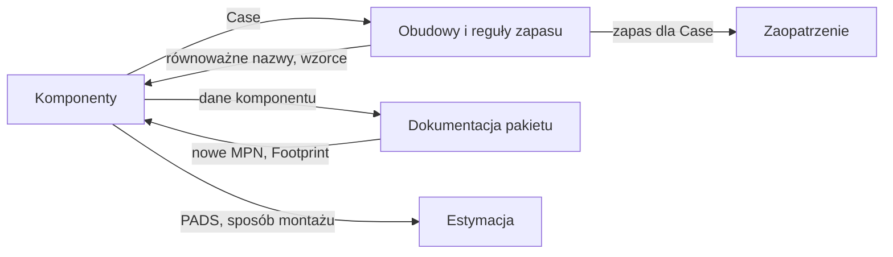

# Obszar Baza komponentów — mapa obszaru

## Cel

Obszar prowadzi **wspólną dla całej firmy wiedzę o komponentach**: parametry, Case, Footprint, sposób montażu, PADS oraz zasady związane z obudowami (równoważne nazwy, wzorce nazewnictwa, reguły zapasu). Odpowiada na pytania: czym jest dany MPN, jak go montujemy i ile kupujemy ponad BOM.

## Granica

| Obszar posiada | Obszar nie posiada (kto posiada) |
|---|---|
| komponenty (MPN + producent) z parametrami, Case, Footprint, sposobem montażu, PADS | linie BOM, MPN zatwierdzone i niedozwolone linii → Dokumentacja pakietu |
| statusy zatwierdzenia danych komponentu (kto, kiedy) | ilości do zamówienia, stan magazynu → Zaopatrzenie |
| footprinty dedykowane (wariant oznaczony Klientem) | Klient jako kontrahent → Usługi wspólne |
| powiązanie komponentu z symbolami magazynowymi (własny / powierzony przez Klienta) | symbole i stany w systemie magazynowym → system magazynowy |
| słowniki: typy, obudowy, równoważne nazwy obudów, wzorce nazewnictwa | ekran panelu administratora → Usługi wspólne (obszar posiada dane) |
| reguły zapasu (obudowa → grupa → progi) i zapamiętane przypisania obudów | |

Inne obszary współpracują z obszarem tylko przez kontrakt zewnętrzny (do utworzenia).

## Reguły obszaru

1. **Obszar jest jedynym właścicielem danych komponentu** ([Mapa obszarów](../../system/02%20Mapa%20obszarów.md), zasada 2). Inne obszary zgłaszają zmiany (nowy MPN, Footprint po zatwierdzeniu P&P); zgłoszenie nie nadpisuje bazy po cichu.
2. **Komponent = MPN + producent.** Klient nie jest częścią klucza — własność fizyczną towaru opisuje symbol magazynowy. Poprawka parametru dotyczy wszystkich pakietów i Klientów.
3. **Dane zatwierdzone są oznaczone** (kto, kiedy). Zmiana danej zatwierdzonej cofa ją do niezatwierdzonej.
4. **Słowniki mają stały kod** niezależny od nazwy ([ADR-0006](../../decyzje/ADR-0006%20Stałe%20identyfikatory%20i%20powiązania%20zewnętrzne.md)).
5. **Grupowe zmiany pokazują listę „było → będzie”** do zatwierdzenia (zmiana nazwy obudowy, wzorca, ustawień).

## Moduły

| Moduł | Odpowiada za | Karta | Kod |
|---|---|---|---|
| Komponenty | komponent, parametry, statusy, footprinty dedykowane, symbole magazynowe, PADS, migracja z dataPart | [Komponenty](moduly/Komponenty.md) | `src/iPart.Core/Components`, `src/iPart.Core/Units`, `src/iPart.Infrastructure` (SqlServerComponentService, Import) |
| Obudowy i reguły zapasu | słowniki obudów, równoważne nazwy, wzorce nazewnictwa, reguły zapasu | [Obudowy i reguły zapasu](moduly/Obudowy%20i%20reguły%20zapasu.md) | brak |

## Relacje między modułami

Komponent wskazuje obudowę (Case). Reguły zapasu i porównanie obudów korzystają ze słowników obudów.

## Przebiegi

**Nowy MPN z BOM Klienta**
1. Import BOM nie rozpoznaje MPN (Dokumentacja pakietu) — trafia na listę „Nowe MPN spoza bazy”.
2. Opiekun Projektu dodaje komponent bez zatwierdzenia albo z zatwierdzeniem, uzupełnia Case i PADS.
3. Po zatwierdzeniu P&P Footprint trafia do komponentu jako zatwierdzony (wybór „w bazie / tylko w projekcie”).

**Nowy MPN zamiennika od zakupowca**
1. Zakupowiec dopisuje MPN z podstawowymi danymi (zakres danych — otwarte pytanie).
2. Opiekun Projektu uzupełnia i zatwierdza pozostałe dane.

**Obudowa bez reguły zapasu**
1. Zaopatrzenie liczy zapas i nie znajduje grupy dla Case.
2. Zakupowiec przypisuje obudowę do grupy; decyzja jest zapamiętywana jako podpowiedź.

## Otwarte pytania

| Pytanie | Kto może odpowiedzieć |
|---|---|
| Jakie podstawowe dane podaje zakupowiec, dopisując nowy MPN zamiennika? | Kierownik działu Obsługi Projektu, Zakupowiec |
| Logika komponentów krytycznych (Critical) | Kierownik działu Obsługi Projektu |

## Decyzje

- [ADR-0005](../../decyzje/ADR-0005%20Schemat%20bazy%20na%20obszar.md) Schemat bazy na obszar
- [ADR-0006](../../decyzje/ADR-0006%20Stałe%20identyfikatory%20i%20powiązania%20zewnętrzne.md) Stałe identyfikatory
- [ADR-0007](../../decyzje/ADR-0007%20Jeden%20mechanizm%20historii%20zmian.md) Jeden mechanizm historii zmian
