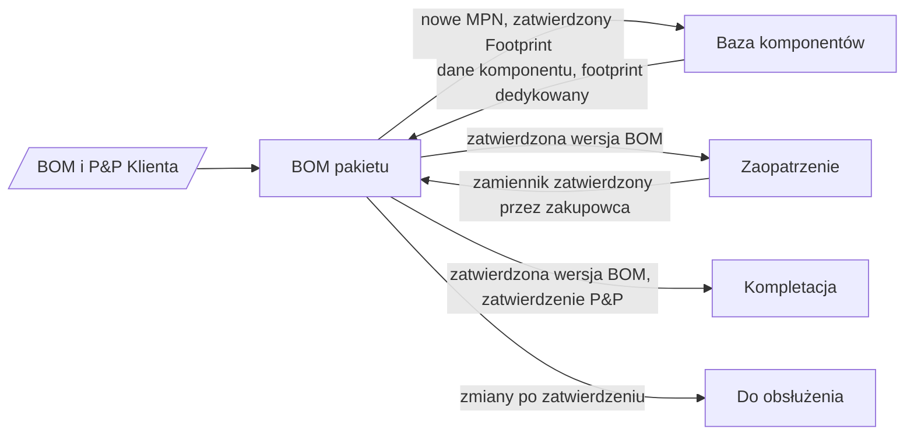

# Obszar Dokumentacja pakietu — mapa obszaru

## Cel

Obszar zamienia dokumentację Klienta (BOM i P&P) na **BOM pakietu**: jedno źródło danych o tym, co i gdzie montujemy, dla wszystkich działów. Odpowiada na pytania: czy dokumentacja Klienta jest spójna, co dokładnie montujemy w każdej linii, jakie MPN są dopuszczone, a jakie zakazane, i która wersja BOM obowiązuje dla danego ZK.

## Granica

| Obszar posiada | Obszar nie posiada (kto posiada) |
|---|---|
| pakiet: Klient, nazwa, odnośnik do archiwum Excel, powiązanie z `EssegiId` | dane Klienta jako kontrahenta → Usługi wspólne |
| rewizje importu z kopią plików BOM i P&P ([ADR-0008](../../decyzje/ADR-0008%20Pliki%20źródłowe%20w%20bazie%20danych.md)) | dane komponentu: parametry, Case, Footprint, sposób montażu → Baza komponentów |
| linie pakietu, porównanie BOM–P&P, potwierdzenie linii z podstawą | zakupy, ilości do zamówienia, zapas → Zaopatrzenie |
| wersje BOM (robocza, zatwierdzona, zarchiwizowana; bazowa i dla ZK) | partie, opakowania, wydania → Kompletacja |
| sekcja TS linii, Part TS, sposób wydania linii | historia zmian jako mechanizm, blokady, „Do obsłużenia” → Usługi wspólne |
| MPN zatwierdzone (z podstawą) i MPN niedozwolone (z powodem) | |
| zatwierdzenie P&P i zatwierdzenie BOM | |

Inne obszary współpracują z obszarem tylko przez [kontrakt zewnętrzny](01%20Kontrakt%20zewnętrzny.md).

## Reguły obszaru

1. **Obszar jest jedynym właścicielem BOM pakietu** ([Mapa obszarów](../../system/02%20Mapa%20obszarów.md), zasada 1). Zamiennik od zakupowca przychodzi jako zgłoszenie i jest zapisywany tutaj.
2. **Dane Klienta są niezmienne.** Sekcja Oryginał i rewizja importu nie są poprawiane; ustalenia firmy trafiają do sekcji TS. Normalizacja służy tylko do porównania.
3. **Zatwierdzona wersja BOM jest niezmienna.** Zmiana to nowa wersja ([ADR-0007](../../decyzje/ADR-0007%20Jeden%20mechanizm%20historii%20zmian.md)).
4. **Nic po cichu.** Każda zmiana danych z bazy komponentów, ustawień albo nowego BOM Klienta pokazuje listę „było → będzie” do decyzji.
5. **Każda decyzja ma podstawę** (kto, kiedy, dlaczego): potwierdzenie linii, MPN zatwierdzony, usunięcie zakazu.

## Moduły

| Moduł | Odpowiada za | Karta | Kod |
|---|---|---|---|
| BOM pakietu | import i porównanie BOM i P&P, linie, sekcja TS, MPN, wersje BOM, zatwierdzenia | [BOM pakietu](moduly/BOM%20pakietu.md) | `src/iPart.Core/Packages`, `src/iPart.Infrastructure/Packages` |

Import, porównanie i opracowanie BOM to jeden moduł ([ADR-0003](../../decyzje/ADR-0003%20Comparator%20i%20iPart%20jako%20jeden%20moduł.md)). Obszar ma dziś jeden moduł; podział nastąpi, gdy któraś część urośnie (np. zatwierdzenie P&P per technologia).

## Relacje z innymi obszarami

## Przebiegi

**Nowy pakiet**
1. Opiekun Projektu tworzy pakiet i importuje BOM i P&P Klienta (BOM pakietu). Pliki zapisują się w bazie.
2. Aplikacja rozbija desygnatory, porównuje BOM z P&P i rozpoznaje MPN w Bazie komponentów; uzupełnia dane linii.
3. Opiekun rozstrzyga rozbieżności, przygotowuje pytania do Klienta i potwierdza linie z podstawą.
4. Technolog SMT zatwierdza P&P; Footprinty trafiają do Bazy komponentów jako zgłoszenie.
5. Opiekun zatwierdza BOM — wersja trafia do Zaopatrzenia i Kompletacji.

**Nowy BOM od Klienta dla istniejącego pakietu**
1. Opiekun importuje nową rewizję; linie dopasowują się po desygnatorach.
2. Aplikacja pokazuje „było → będzie”; Opiekun nanosi wszystko, część albo zaczyna od początku.
3. Zatwierdzenie tworzy nową wersję BOM; przejście ZK w toku na nową wersję proponuje Opiekun, zatwierdza zakupowiec.

**Zamiennik od zakupowca**
1. Zakupowiec wybiera MPN spoza listy (Zaopatrzenie).
2. Takie same lub lepsze parametry — akceptacja automatyczna; w innym przypadku zakupowiec zatwierdza z podstawą.
3. BOM pakietu zapisuje MPN na stałe albo w wersji BOM dla ZK; Opiekun Projektu dostaje informację.

## Decyzje robocze (do akceptacji)

Decyzje robocze modułu są w [karcie BOM pakietu](moduly/BOM%20pakietu.md).

## Otwarte pytania

| Pytanie | Kto może odpowiedzieć |
|---|---|
| Czy Pin-In-Paste podlega zatwierdzeniu P&P przez Technologa SMT? | Technolog SMT |
| Jak pakiet wiąże się z `EssegiId` w dokumentacji pakietów? | drugi developer |

## Decyzje

- [ADR-0001](../../decyzje/ADR-0001%20iPart%20jako%20system%20przejściowy%20do%20czasu%20modułu%20BOM.md) iPart jako system przejściowy
- [ADR-0003](../../decyzje/ADR-0003%20Comparator%20i%20iPart%20jako%20jeden%20moduł.md) Comparator i iPart jako jeden moduł
- [ADR-0006](../../decyzje/ADR-0006%20Stałe%20identyfikatory%20i%20powiązania%20zewnętrzne.md) Stałe identyfikatory
- [ADR-0007](../../decyzje/ADR-0007%20Jeden%20mechanizm%20historii%20zmian.md) Jeden mechanizm historii zmian
- [ADR-0008](../../decyzje/ADR-0008%20Pliki%20źródłowe%20w%20bazie%20danych.md) Pliki źródłowe w bazie danych
