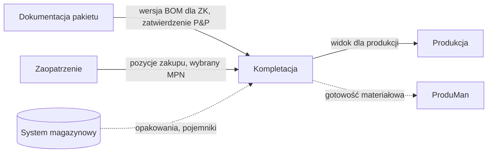

# Obszar Kompletacja — mapa obszaru

Obszar do wydzielenia: gospodarkę materiałową może przejąć iPart albo moduł BOM systemu magazynowego ([Mapa obszarów](../../system/02%20Mapa%20obszarów.md), zasada 5). Do czasu decyzji opisujemy go na poziomie mapy i [kontraktu](01%20Kontrakt%20zewnętrzny.md), bez kart modułów.

## Cel

Obszar przygotowuje komponenty do produkcji: dzieli ZK na partie, przypisuje opakowania z magazynu do linii BOM, liczy, ile wydano i ile brakuje, oraz pokazuje produkcji desygnację opakowań.

## Granica

| Obszar posiada | Obszar nie posiada (kto posiada) |
|---|---|
| partie (PP): podział ilości ZK | ZK, wersje BOM, linie → Dokumentacja pakietu |
| kompletacja linii w partii: opakowania, wydano, „kompletne”, uwagi | pozycje zakupu, wybrany MPN, ZD → Zaopatrzenie |
| import opakowań z systemu magazynowego (kopia pliku) | opakowania i stany jako źródło → system magazynowy |
| zmiany do obsłużenia przez magazyn i historia kompletacji | |
| gotowość partii dla linii SMT | |
| widok dla produkcji (dPart) | |
| symulacja „czego zabraknie przy większej ilości” | |

## Reguły obszaru

### Partie

1. **Partia = podział ilości ZK** (w zestawieniu z kilkoma ZK — ilość dla każdego ZK). Wszystkie partie ZK korzystają z tej samej wersji BOM dla ZK; każda ma własną kompletację.
2. **Partie tworzy magazyn** na podstawie informacji od Opiekuna klienta albo produkcji.
3. Zmiany Klienta po sprawdzeniu PP1 → zmiana wersji BOM dla ZK, obowiązuje kolejne partie.
4. **„Zmień ilości” to symulacja** — czego i ile zabraknie przy większej ilości partii albo ZK; bez zapisu.

### Opakowania i wydania

5. **Import opakowań** z pliku systemu magazynowego w pierwszej wersji, docelowo odczyt bezpośredni. Przypisanie po MPN wybranym przez zakupowca, normalizacja jak przy porównaniu BOM.
6. **Jedno opakowanie może obsłużyć kilka linii;** aplikacja sprawdza, czy ilość wystarcza dla wszystkich, a jeśli nie — ostrzeżenie do świadomej akceptacji. Konflikty i braki rozstrzyga magazyn; decyzje w historii.
7. Wycofanie opakowania z kompletacji — z powodem. Nieprzypisane opakowania liczone od nowa przy każdym imporcie.
8. **„Wydano”** = suma z przypisanych opakowań (ilość osobno per opakowanie); opakowanie wspólne dla kilku linii — ilość dzielona według zapotrzebowania. Korekta ręczna z powodem; linia kompletna bez liczenia — jawne oznaczenie z powodem.
9. **„Max płytek”** ze wszystkich linii, bez limitu; pomijane tylko DNP. **PCB liczona jak każda inna linia.**
10. **Numer pojemnika** z kolumny „Pojemnik” w pliku z systemu magazynowego.
11. **Sposób wydania** (produkcja SMT, produkcja THT, serwis, bezpośrednio do Klienta) przychodzi z linii BOM. „Materiały dodatkowe” — na razie pomijamy.

### Zatwierdzenie P&P i gotowość

12. Kompletacja może się zacząć bez zatwierdzenia P&P. **Udostępnienie widoku produkcji i oznaczenie partii jako gotowej dla linii SMT wymaga zatwierdzenia P&P przez Technologa SMT.** Pakiet bez linii SMT nie wymaga.
13. Zatwierdzenia per technologia — tak, by można było dodać zatwierdzenie przez Technologa THT.
14. Linia ze statusem MPN „do weryfikacji” blokuje przypisanie opakowań do potwierdzenia przez Opiekuna Projektu albo zakupowca.

### Zmiany po rozpoczęciu kompletacji

15. Zmiana linii z przypisanymi opakowaniami → pozycja „Do obsłużenia” dla magazynu („było → będzie” + podpowiedź: zwrócić / dobrać / bez zmian). Partii z nieobsłużonymi zmianami nie można oznaczyć jako gotowej. Produkcja widzi te linie oznaczone.
16. Zmiana linii bez opakowań — zwykła aktualizacja. Sposób montażu i inne pola zawsze aktualizowane (wyjątki = wersja BOM dla ZK).
17. Obsłużenie nie wraca do Opiekuna Projektu ani zakupowca — **zapis w historii kompletacji**.
18. Kompletacja czyta dane zakupowe bezpośrednio, dla wszystkich partii; zakupowiec widzi wydania i uwagi magazynu per partia na bieżąco. Ceny ukryte uprawnieniami.

### Widok dla produkcji (dPart)

19. Widok na komputerze przy stanowisku przyjęcia opakowań, ze zmianami „było → będzie”; desygnatory z podziałem na ZK jako dane. Import nie tworzy osobnego dokumentu. Zmiana ilości w widoku — porzucona (zastępuje ją symulacja).

### Kolory

20. Kompletna 70AD47, częściowo FFC000, brak FFC7CE / 9C0006; **wydane ponad zapotrzebowanie dla THT, MECH, Press-Fit i Plugs — FF5050** (polityka: te elementy wydajemy prawie zawsze na styk). Statusy MPN według palety kompletacji ([Ustawienia i panel administratora](../Usługi%20wspólne/moduly/Ustawienia%20i%20panel%20administratora.md)).

## Moduły

Bez kart do czasu decyzji o przejęciu. Kandydaci: **Partie i kompletacja**, **Widok dla produkcji**.

## Relacje z innymi obszarami

## Przebiegi

**Kompletacja partii**
1. Magazyn tworzy partię z ilością dla każdego ZK.
2. Magazyn importuje opakowania; aplikacja przypisuje je do linii i liczy „Wydano”.
3. Po zatwierdzeniu P&P i obsłużeniu zmian magazyn oznacza partię jako gotową; produkcja widzi desygnację.

## Decyzje robocze (do akceptacji)

1. **Widok dla produkcji** zamiast pliku dPart; dPart do większego dopracowania w przyszłości ([Decyzje VBA](../../robocze/Decyzje%20VBA.md), 5.2).

## Otwarte pytania

| Pytanie | Kto może odpowiedzieć |
|---|---|
| Kto przejmie Kompletację: iPart czy moduł BOM systemu magazynowego? | Kierownik działu Obsługi Projektu, developer IT, drugi developer |
| Jak Kompletacja ma się do obszaru MRP ProduMan (zlecenie kompletacji, zgłoszenie braku)? | developer IT, Kierownik działu Obsługi Projektu |
| Czy PP odpowiada ZP ProduMan? | Kierownik działu Obsługi Projektu, developer IT |
| Skąd dziś bierze się wartość „Wydano” w cPart (szablon rev3.3 bez formuły i makra)? | Magazyn |
| Czy przy zmianach Klienta po PP1 potrzebna jest osobna wersja BOM dla partii? | Kierownik działu Obsługi Projektu |

## Decyzje

- [ADR-0009](../../decyzje/ADR-0009%20Zestawienie%20zakupowe%20zamiast%20osobnej%20ścieżki%20łączenia.md) Zestawienie zakupowe zamiast osobnej ścieżki łączenia
- [ADR-0008](../../decyzje/ADR-0008%20Pliki%20źródłowe%20w%20bazie%20danych.md) Pliki źródłowe w bazie danych
