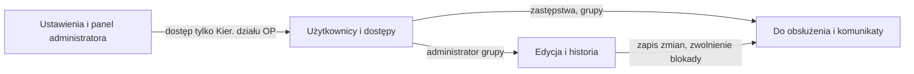

# Obszar Usługi wspólne — mapa obszaru

## Cel

Obszar daje wszystkim obszarom te same mechanizmy pracy: kto pracuje i co może, co ma do obsłużenia, jak się komunikuje, jak edytuje i jak zapisuje historię. Dziś każdy plik Excel robił to po swojemu albo wcale.

## Granica

| Obszar posiada | Obszar nie posiada (kto posiada) |
|---|---|
| użytkownik (Guid konta Nexo i kopia danych konta), dostępy, grupy, administratorzy grup, zastępstwa | konta, hasła i logowanie → Nexo przez LoginApi; dział, role w działach, umiejętności → moduł Pracownicy ProduMan |
| Klient (dane wspólne dla obszarów) | dane biznesowe obszarów (BOM, komponenty, zakupy, kompletacja) |
| lista „Do obsłużenia”, komunikaty z potwierdzeniami | historia danych obszaru → schemat tego obszaru (budowa wspólna) |
| blokady edycji i szkice | słowniki obudów, reguły zapasu → Baza komponentów |
| ustawienia (firma → Klient → pakiet → linia), kolory danych | |
| panel administratora (ekran) | |
| wspólna budowa historii zmian ([ADR-0007](../../decyzje/ADR-0007%20Jeden%20mechanizm%20historii%20zmian.md)) | |

Inne obszary korzystają z obszaru tylko przez [kontrakt zewnętrzny](01%20Kontrakt%20zewnętrzny.md).

## Reguły obszaru

1. **Jeden mechanizm wszędzie.** „Do obsłużenia”, komunikaty, blokady, zastępstwa i historia działają tak samo we wszystkich obszarach.
2. **Grupa ≠ rola.** Grupa służy do zastępstw, administratorów i zadań bez operatora; rola — do dostępów.
3. **Bez przypisań do Klientów.** Pozycje trafiają do operatora tematu, a gdy go nie ma — do grupy.
4. **Użytkownik loguje się kontem Nexo** przez LoginApi ([ADR-0011](../../decyzje/ADR-0011%20Logowanie%20kontem%20Nexo%20przez%20LoginApi.md)); tożsamością jest Guid konta. Dostępy, grupy i zastępstwa prowadzimy lokalnie, po Guidzie konta — tak, by dało się je przenieść do wspólnego modułu uprawnień firmy.

## Moduły

| Moduł | Odpowiada za | Karta | Kod |
|---|---|---|---|
| Użytkownicy i dostępy | odniesienie do konta, role, macierz dostępów, grupy, administratorzy grup, zastępstwa | [Użytkownicy i dostępy](moduly/Użytkownicy%20i%20dostępy.md) | brak |
| Do obsłużenia i komunikaty | lista „Do obsłużenia”, operator tematu, komunikaty z potwierdzeniami | [Do obsłużenia i komunikaty](moduly/Do%20obsłużenia%20i%20komunikaty.md) | brak |
| Edycja i historia | sesje edycji, blokady, szkice, wspólna budowa historii zmian | [Edycja i historia](moduly/Edycja%20i%20historia.md) | częściowo: historia komponentów w `src/iPart.Infrastructure` |
| Ustawienia i panel administratora | Klient, ustawienia, kolory danych, panel administratora | [Ustawienia i panel administratora](moduly/Ustawienia%20i%20panel%20administratora.md) | częściowo: `src/iPart.App/Resources/DataColors.xaml` |

## Relacje między modułami

## Przebiegi

**Zmiana zatwierdzonego BOM**
1. Opiekun zapisuje zmiany z komentarzem (Edycja i historia).
2. Do zakupowca ZK i — gdy kompletacja ruszyła — do magazynu trafia pozycja „Do obsłużenia”; w czasie zastępstwa — do zastępcy.
3. Odbiorca oznacza pozycję jako obsłużoną (jak) albo odrzuconą (z powodem).

**Porzucona blokada**
1. Blokada wygasa po 1 godzinie bez aktywności; szkic zostaje.
2. Administrator grupy może zwolnić ją od razu, z powodem — właściciel dostaje pozycję „Do obsłużenia”.

## Otwarte pytania

| Pytanie | Kto może odpowiedzieć |
|---|---|
| Dostęp do listy aktywnych kont (widok kont ProduMana) — sposób do ustalenia po stronie ProduMana | developer IT |
| Powiadomienia e-mail lub Teams (integracja z Teams ProduMan) — kiedy i jak | developer IT |

## Decyzje

- [ADR-0007](../../decyzje/ADR-0007%20Jeden%20mechanizm%20historii%20zmian.md) Jeden mechanizm historii zmian
- [ADR-0006](../../decyzje/ADR-0006%20Stałe%20identyfikatory%20i%20powiązania%20zewnętrzne.md) Stałe identyfikatory
- [ADR-0005](../../decyzje/ADR-0005%20Schemat%20bazy%20na%20obszar.md) Schemat bazy na obszar
