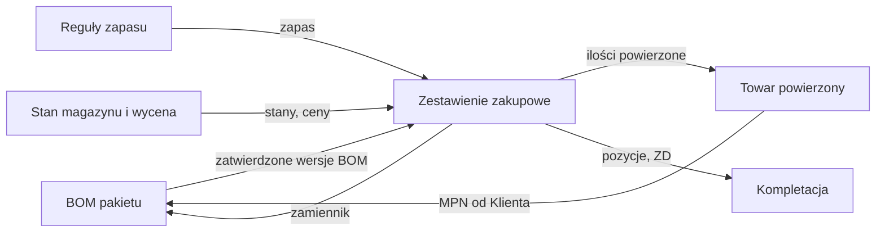

# Obszar Zaopatrzenie — mapa obszaru

## Cel

Obszar ustala, **co, ile i od kogo kupić** pod ZK: zbiera ZK jednego Klienta w zestawienie zakupowe, wylicza ilości (BOM, zapas, stan magazynu), wybiera MPN i obsługuje towar powierzony przez Klienta. Zamówienia (ZD) powstają w innym systemie — iPart je tylko wskazuje.

## Granica

| Obszar posiada | Obszar nie posiada (kto posiada) |
|---|---|
| zestawienia zakupowe (1..n ZK jednego Klienta), w tym łączenie BOM-ów | linie, MPN zatwierdzone i niedozwolone, zamienniki → Dokumentacja pakietu |
| pozycje zakupu: połączone linie, decyzje „połącz / nie łącz”, wybrany MPN, ilości, dostawca, LT, ceny, kursy | reguły zapasu → Baza komponentów |
| odnośniki do ZD (numer, ilość, LT) | ZD, ZK jako dokumenty → Nexo |
| import stanu magazynu i cennika, import wyceny | partie, opakowania, wydania → Kompletacja |
| lista komponentów powierzanych i import odesłanej listy | stan magazynowy jako źródło → system magazynowy |
| zapamiętane decyzje łączenia (podpowiedzi) | |

Inne obszary współpracują z obszarem tylko przez [kontrakt zewnętrzny](01%20Kontrakt%20zewnętrzny.md).

## Reguły obszaru

1. **Pracujemy tylko na zatwierdzonych wersjach BOM** ([Mapa obszarów](../../system/02%20Mapa%20obszarów.md), zasada 3). MPN wstrzymane nie są widoczne.
2. **Zaopatrzenie nie zmienia BOM.** Zamiennik zatwierdzony przez zakupowca trafia jako zgłoszenie do BOM pakietu — na stałe albo w wersji BOM dla ZK.
3. **Zestawienie obejmuje ZK tylko jednego Klienta.** Jeden ZK jest tylko w jednym zestawieniu, w całości ([ADR-0009](../../decyzje/ADR-0009%20Zestawienie%20zakupowe%20zamiast%20osobnej%20ścieżki%20łączenia.md)).
4. **Ceny widzą tylko uprawnione role:** Zakupowiec, Kierownik Logistyki, Kierownik działu Obsługi Projektu.
5. **Zmiana BOM lub ilości ZK po rozpoczęciu zakupów** trafia do zakupowca jako „było → będzie” (dokupić / anulować / nadmiar ze zmiany). Nic po cichu.

## Moduły

| Moduł | Odpowiada za | Karta | Kod |
|---|---|---|---|
| Zestawienie zakupowe | zestawienie, łączenie pozycji, wybór MPN, ilości, odnośniki do ZD | [Zestawienie zakupowe](moduly/Zestawienie%20zakupowe.md) | brak |
| Stan magazynu i wycena | import stanu i cennika, import wyceny, kursy, widoczność cen | [Stan magazynu i wycena](moduly/Stan%20magazynu%20i%20wycena.md) | brak |
| Towar powierzony | lista komponentów powierzanych, import odesłanej listy | [Towar powierzony](moduly/Towar%20powierzony.md) | brak |

Nadwyżka zakupowa i podsumowanie kosztów — **odłożone**, czekają na Kierownika Logistyki ([Decyzje VBA](../../robocze/Decyzje%20VBA.md), 4.5).

## Relacje między modułami

## Przebiegi

**Zakup pod jeden ZK**
1. Po zatwierdzeniu BOM zakupowiec tworzy zestawienie z jednym ZK (pokazywane po numerze ZK).
2. Aplikacja wylicza ilości: BOM × ilość ZK, zapas z reguł, stan z importu; linie niepotwierdzone nie są liczone.
3. Zakupowiec wybiera MPN z zatwierdzonych albo zgłasza zamiennik; importuje wycenę; wpisuje ZD.
4. Kompletacja czyta pozycje bezpośrednio.

**Łączenie kilku ZK**
1. Zakupowiec, Opiekun Projektu albo Kierownik działu Obsługi Projektu tworzy zestawienie `FUSEnnn/rrrr` z ZK jednego Klienta.
2. Pozycje bez wątpliwości łączą się automatycznie; wątpliwe rozstrzyga zakupowiec.
3. Lista komponentów powierzanych powstaje dla całego zestawienia.

## Otwarte pytania

| Pytanie | Kto może odpowiedzieć |
|---|---|
| Nadwyżka zakupowa i podsumowanie kosztów: cel, sposób liczenia, rozliczenie łączenia | Kierownik Logistyki |
| Jak iPart czyta ZK, ZD i stany z Nexo? | developer IT |

## Decyzje

- [ADR-0009](../../decyzje/ADR-0009%20Zestawienie%20zakupowe%20zamiast%20osobnej%20ścieżki%20łączenia.md) Zestawienie zakupowe zamiast osobnej ścieżki łączenia
- [ADR-0005](../../decyzje/ADR-0005%20Schemat%20bazy%20na%20obszar.md) Schemat bazy na obszar
- [ADR-0008](../../decyzje/ADR-0008%20Pliki%20źródłowe%20w%20bazie%20danych.md) Pliki źródłowe w bazie danych
