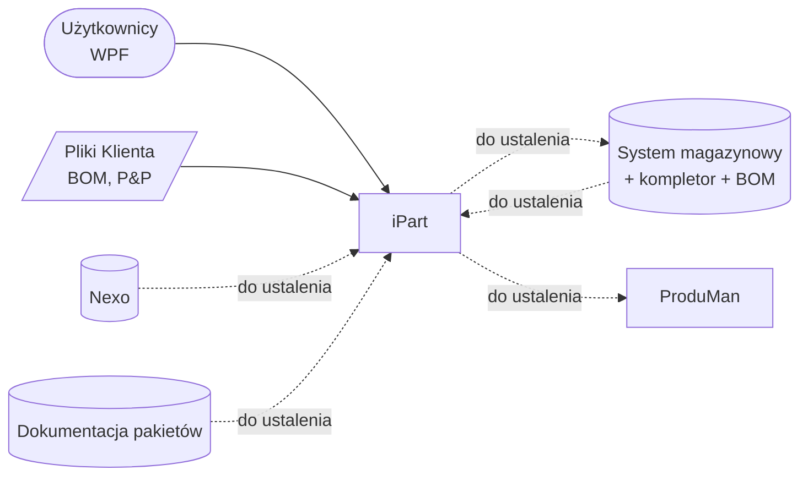

# Kontekst i cel systemu

## Cel

iPart wspiera firmę EMS (montaż elektroniki na zlecenie) w drodze **od dokumentacji Klienta do komponentów wydanych na produkcję**. Obejmuje:
- przyjęcie BOM i P&P Klienta, porównanie i potwierdzenie linii;
- prowadzenie BOM pakietu z Part TS, zamiennikami i wersjami;
- bazę komponentów;
- zakupy komponentów pod ZK, komponenty powierzane i zapas;
- kompletację i desygnację opakowań przy wydaniu na produkcję.

iPart zastępuje **system plików Excel/VBA** (comparator, iPart, fusePart, sPart, cPart, dPart, entPart, scrapPart, dataPart, qPart). Najważniejszy cel to **jedno wspólne źródło danych pakietu**. Decyzje podjęte na dowolnym etapie wracają do tego źródła. Dziś zamiennik od zakupowca w sPart nie wraca do iPart, a decyzje z fusePart nie wracają do BOM.

iPart jest **systemem przejściowym**, który działa do czasu, gdy BOM i dane materiałowe przejmie system magazynowy ([ADR-0001](../decyzje/ADR-0001%20iPart%20jako%20system%20przejściowy%20do%20czasu%20modułu%20BOM.md)).

iPart **nie zastępuje** Nexo, systemu magazynowego, kompletora ani ProduMan. Korzysta z nich jako źródeł danych albo przekazuje im to, co powstaje w iPart.

## Użytkownicy

| Rola | Co robi w systemie |
|---|---|
| Opiekun klienta (rola ProduMan) | jedyny kanał kontaktu z Klientem: przekazuje dokumentację, zmiany i odpowiedzi na pytania; wycenia pracę przy ofercie |
| Operator danych BOM | importuje BOM i P&P Klienta, porównuje je i przygotowuje pytania do Klienta |
| Opiekun Projektu | opracowuje BOM pakietu: synchronizacja z bazą komponentów, Part TS, zamienniki, odpowiedzi Klienta. Osoba kontaktowa dla innych działów. Nazwa roli może się zmienić |
| Kierownik działu Obsługi Projektu | ustala reguły, rozwiązuje nietypowe przypadki, łączy BOM-y do wspólnych zakupów, współustala reguły zapasu |
| Technolog SMT | zatwierdza P&P i Footprint (zgodność z programem SMT) |
| Zakupowiec | wycenia i zamawia komponenty, proponuje zamienniki, zatwierdza przejście ZK w toku na nową wersję BOM |
| Kierownik Logistyki | podsumowuje koszty i nadwyżki zakupowe projektu, współustala reguły zapasu |
| Magazyn | kompletuje komponenty i przygotowuje desygnację opakowań |
| Przyjmujący na produkcji | przyjmują opakowania według desygnacji i rozdzielają je na stanowiska |

## Systemy zewnętrzne

| System | Właściciel | Rola wobec iPart |
|---|---|---|
| **Nexo** (ERP) | firma | ZK, ZD, asortyment, stany. Sposób dostępu do ustalenia |
| **System magazynowy** (z kompletorem i modułem BOM) | drugi developer, osobna baza | stan magazynowy, kompletacja w kompletorze, dokumenty zużycia; moduł BOM w budowie — docelowy właściciel BOM ([ADR-0001](../decyzje/ADR-0001%20iPart%20jako%20system%20przejściowy%20do%20czasu%20modułu%20BOM.md)) |
| **Dokumentacja pakietów** (DokuMan, `EssegiId`) | drugi developer | tożsamość pakietu i jego dokumentacja |
| **ProduMan** | developer IT | zarządzanie produkcją; obszar MRP (zabezpieczenie materiałowe, kompletacje, braki) przewidziany do przejęcia przez inny system |
| **Pliki Klienta** | Klient (przez Opiekuna klienta) | BOM (zwykle `.xlsx`, układ różny u każdego Klienta), P&P (zwykle `.txt`) |

Wszystkie integracje są dziś do ustalenia. Kierunki opisuje [Mapa obszarów](02%20Mapa%20obszarów.md), a szczegóły będą w kontraktach obszarów.

## Stan przejściowy

- **Legacy:** pliki Excel/VBA, każdy pakiet w osobnych plikach, oraz comparator w Power Apps i Power Automate. Działa produkcyjnie.
- **Plików Excel już nie poprawiamy** ([ADR-0002](../decyzje/ADR-0002%20Pliki%20Excel%20nie%20są%20już%20poprawiane.md)). Znalezione w nich błędy służą tylko temu, żeby iPart ich nie powtórzył. Opis działania i błędów: [analiza techniczna](../robocze/analiza-techniczna/README.md).
- **Nowa część:** aplikacja WPF (.NET 10) z bazą SQL Server; wersja 0.1.0 jest wstępna i nie służy do pracy produkcyjnej ([Środowiska](07%20Środowiska.md)).
- **Przejście z Excela:** kierunek ogólny to praca według nowych zasad zamiast przenoszenia starych danych 1:1. Zakres migracji danych z plików jest otwarty.

## Warunki przyszłego przejęcia

iPart budujemy tak, żeby system magazynowy mógł go tanio przejąć ([ADR-0001](../decyzje/ADR-0001%20iPart%20jako%20system%20przejściowy%20do%20czasu%20modułu%20BOM.md)):

1. Pakiet, wersja BOM, linia BOM i komponent mają **stałe identyfikatory publiczne**. Przy migracji przechodzą bez zmian.
2. Każda informacja ma **jednego właściciela zapisu**: jeden obszar iPart albo system zewnętrzny.
3. Obszary komunikują się tylko przez **kontrakty zewnętrzne**. Kontrakty z danymi BOM uzgadniamy z drugim developerem przed implementacją.
4. Przy przejęciu **dane migrują**, a odbiorcy korzystają dalej z tego samego kontraktu. Logiki nie przepisujemy w drugim systemie.

## Powiązane

- [Mapa obszarów](02%20Mapa%20obszarów.md)
- [Słownik](03%20Słownik.md)
- [Rejestr decyzji](../decyzje/README.md)
