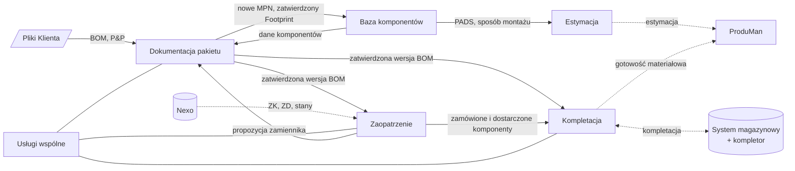

# Mapa obszarów

System dzieli się na **obszary**, czyli duże części odpowiadające sposobom pracy w firmie. Obszar składa się z modułów i komunikuje się z innymi obszarami tylko przez swój kontrakt zewnętrzny. Ten dokument opisuje obszary i relacje między nimi. Moduły są opisane w mapach obszarów.

## Obszary

| Obszar | Odpowiada za | Legacy (pliki Excel) | Dokumentacja |
|---|---|---|---|
| **Dokumentacja pakietu** | import i porównanie BOM i P&P Klienta, potwierdzenie linii, BOM pakietu (Part TS, MPN zatwierdzone i niedozwolone, zamienniki), zatwierdzenie P&P i BOM, wersje BOM | comparator, iPart | [mapa obszaru](../obszary/Dokumentacja%20pakietu/00%20Mapa%20obszaru.md) |
| **Baza komponentów** | komponenty i ich parametry, Case, Footprint, sposób montażu, powiązanie MPN z symbolem magazynowym, słowniki | dataPart | [mapa obszaru](../obszary/Baza%20komponentów/00%20Mapa%20obszaru.md) |
| **Zaopatrzenie** | zapotrzebowanie i zakupy komponentów pod ZK, łączenie BOM-ów do wspólnych zakupów, zgłoszenia zamienników od zakupowca, towar powierzony, reguły zapasu, wycena, nadwyżka zakupowa | sPart, fusePart, entPart, scrapPart | [mapa obszaru](../obszary/Zaopatrzenie/00%20Mapa%20obszaru.md) |
| **Kompletacja** | kompletacja komponentów pod ZK i PP, desygnacja opakowań przy wydaniu na produkcję | cPart, dPart | [mapa obszaru](../obszary/Kompletacja/00%20Mapa%20obszaru.md); bez kart do decyzji o przejęciu (zasada 5) |
| **Estymacja** | szacowanie czasu montażu pakietu | qPart (niedokończony) | [mapa obszaru](../obszary/Estymacja/00%20Mapa%20obszaru.md); bez kart do decyzji o przejęciu (zasada 5) |
| **Usługi wspólne** | użytkownicy, role i administracja dostępów (edycja / odczyt / brak), panel administratora (słowniki obudów, wzorce nazewnictwa), historia zmian, blokady edycji, powiadomienia, ustawienia firmy i Klienta | — (dziś w każdym pliku osobno) | [mapa obszaru](../obszary/Usługi%20wspólne/00%20Mapa%20obszaru.md) |

## Relacje

Diagram pokazuje kierunek docelowy. Strzałka nie oznacza działającej integracji.

## Zasady między obszarami

1. **Dokumentacja pakietu jest jedynym właścicielem BOM pakietu**: linii, Part TS, MPN zatwierdzonych i niedozwolonych oraz wersji BOM. Inne obszary nie zmieniają BOM. Decyzja podjęta w innym obszarze, np. zamiennik od zakupowca, wraca do BOM jako zgłoszenie do Dokumentacji pakietu. Tak realizujemy cel „jedno źródło danych pakietu” z [Kontekstu](01%20Kontekst%20i%20cel%20systemu.md).
2. **Baza komponentów jest właścicielem danych komponentu**: parametrów, Case, Footprint i sposobu montażu. Dokumentacja pakietu czyta te dane i zgłasza zmiany, np. nowe MPN albo Footprint po zatwierdzeniu P&P. Zgłoszenia nie nadpisują bazy po cichu.
3. **Zaopatrzenie i Kompletacja pracują tylko na zatwierdzonej wersji BOM.** Nie widzą wersji roboczej ani zamienników z wstrzymaną decyzją.
4. **Obszar komunikuje się z innymi tylko przez swój kontrakt zewnętrzny.** Właścicielem kontraktu jest obszar, który go wystawia.
5. **Kompletacja i Estymacja są obszarami do wydzielenia.** ProduMan przewiduje, że gospodarkę materiałową (obszar MRP) i estymację przejmie inny system. Nie wiadomo jeszcze, czy będzie to iPart, czy moduł BOM systemu magazynowego. Do czasu decyzji oba obszary w iPart opisujemy na poziomie mapy i kontraktu, bez kart modułów.

6. **Zamiennik od zakupowca zapisuje się w BOM pakietu (Dokumentacja pakietu), a nie w Zaopatrzeniu.** Zaopatrzenie wysyła zgłoszenie, Dokumentacja pakietu zapisuje zmianę — na stałe albo w wersji BOM dla ZK.
7. **Łączenie BOM-ów należy do Zaopatrzenia** jako zestawienie zakupowe bez własnych decyzji o BOM, tylko w obrębie jednego Klienta ([ADR-0009](../decyzje/ADR-0009%20Zestawienie%20zakupowe%20zamiast%20osobnej%20ścieżki%20łączenia.md)).

## Otwarte pytania

| Pytanie | Kto może odpowiedzieć |
|---|---|
| Kto przejmie Kompletację i Estymację: iPart czy moduł BOM systemu magazynowego? | Kierownik działu Obsługi Projektu, developer IT, drugi developer |
| Jak Kompletacja iPart ma się do obszaru MRP ProduMan (zlecenie kompletacji, zgłoszenie braku)? Czy cPart i dPart to ta sama kompletacja? | developer IT, Kierownik działu Obsługi Projektu |
| Jak iPart czyta ZK, ZD i stany z Nexo: widoki SQL, API, pliki? | developer IT |
| Czy PP z plików Excel odpowiada ZP ProduMan? | Kierownik działu Obsługi Projektu, developer IT |
| Jak pakiet w iPart wiąże się z `EssegiId` w dokumentacji pakietów? | drugi developer |

## Powiązane

- [Kontekst i cel systemu](01%20Kontekst%20i%20cel%20systemu.md)
- [Słownik](03%20Słownik.md)
- [Rejestr decyzji](../decyzje/README.md)
