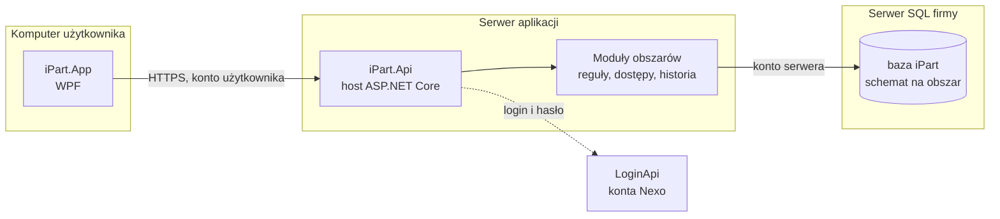

# Architektura techniczna

> **Pilotaż:** bez serwera aplikacji — klient WPF z warstwą operacji w tym samym procesie łączy się z bazą bezpośrednio ([ADR-0014](../decyzje/ADR-0014%20Pilotaż%20bez%20serwera%20i%20z%20kopiami%20danych%20ProduMana.md)). Poniżej układ docelowy po pilotażu.
>
> **Szkic.** Układ wynika z [ADR-0010](../decyzje/ADR-0010%20Serwer%20aplikacji%20między%20klientem%20a%20bazą.md) i [ADR-0005](../decyzje/ADR-0005%20Schemat%20bazy%20na%20obszar.md). Szczegóły w sekcji „Decyzje robocze” czekają na akceptację i uzgodnienie z IT.

## Układ

- **Aplikacja WPF** pokazuje dane i zbiera decyzje. Nie łączy się z bazą.
- **Serwer aplikacji** rozpoznaje użytkownika, sprawdza dostęp, wykonuje reguły i zapisuje historię. Jeden proces dla wszystkich obszarów (modularny monolit).
- **Baza** — jedna, schemat na obszar; dostęp ma tylko konto serwera.

## Elementy

| Element | Rola | Gdzie (docelowo) |
|---|---|---|
| Klient WPF (.NET 10) | widoki, nawigacja ViewModel-first, CommunityToolkit.Mvvm, Material Design, kolory przez tokeny | `src/iPart.App` |
| Klient API | wywołania serwera dla ViewModeli | `src/iPart.Client` |
| Kontrakty | DTO i `Result<T>` wymieniane między klientem a serwerem i między modułami | `src/iPart.Contracts` |
| Host serwera (.NET 10) | punkty wejścia HTTP, logowanie i sesja, rejestracja modułów | `src/iPart.Api` |
| Moduły (.NET 8) | po jednym na obszar: `Domain` (model i reguły), `Application` (handlery komend, odczyty), `Infrastructure` (EF Core 8, własny `DbContext` i schemat) | `src/Modules/<Obszar>/iPart.<Obszar>.{Domain,Application,Infrastructure}` |
| Wspólne (.NET 8) | klasa bazowa agregatu, `Result<T>`, historia zmian, Outbox, czas | `src/iPart.BuildingBlocks` |

Układ według [ADR-0012](../decyzje/ADR-0012%20Budowa%20modułów%20zgodna%20z%20ProduMan.md). Dzisiejsze projekty `iPart.Core` i `iPart.Infrastructure` (0.1.0) rozdzielamy na moduły w etapie 1 ([Kierunek i etapy rozwoju](05%20Kierunek%20i%20etapy%20rozwoju.md)).

## Zasady

1. **Obszar posiada swoje tabele.** Inny obszar korzysta z nich tylko przez kontrakt zewnętrzny, nigdy przez odczyt tabel ([ADR-0005](../decyzje/ADR-0005%20Schemat%20bazy%20na%20obszar.md)).
2. **Dostęp sprawdza serwer** przy każdej operacji; klient tylko ukrywa niedostępne funkcje.
3. **Jedna operacja użytkownika = jedna transakcja = jeden zestaw zmian w historii** ([ADR-0007](../decyzje/ADR-0007%20Jeden%20mechanizm%20historii%20zmian.md)).
4. **Klient i serwer sprawdzają zgodność wersji** przy połączeniu; niezgodny klient dostaje komunikat zamiast błędu.

## Decyzje robocze (do akceptacji)

1. **Technologia serwera:** host ASP.NET Core na .NET 10, JSON przez HTTPS; biblioteki modułów na .NET 8 ([ADR-0012](../decyzje/ADR-0012%20Budowa%20modułów%20zgodna%20z%20ProduMan.md)).
2. **Sesja:** po udanym logowaniu kontem Nexo (LoginApi — ADR-0011) serwer wydaje własny token sesji o ograniczonej ważności; uprawnienia czyta przy każdej operacji (pamięć na minutę), nie z sesji — odebranie działa bez ponownego logowania.
3. **Outbox obsługiwany w procesie serwera** zaraz po zapisie i ponawiany przy starcie — tak, by pozycja „Do obsłużenia” nie zginęła przy błędzie. Bez brokera wiadomości, dopóki iPart jest jednym procesem.
4. **Czas:** zapis w UTC (kolumny `…Utc`), wyświetlanie w czasie polskim (unikamy problemu mieszania czasów znanego z ProduMan).

## Otwarte pytania

| Pytanie | Kto może odpowiedzieć |
|---|---|
| Gdzie uruchomić serwer aplikacji (usługa Windows, IIS), adres, certyfikat HTTPS, konto serwera do bazy | IT |
| Dostęp serwera do LoginApi (`https://login.api.ts/api`) i do widoku kont ProduMana | IT, developer IT |
| Środowisko testowe (wzór ProduMan: kopia produkcji) | IT |
