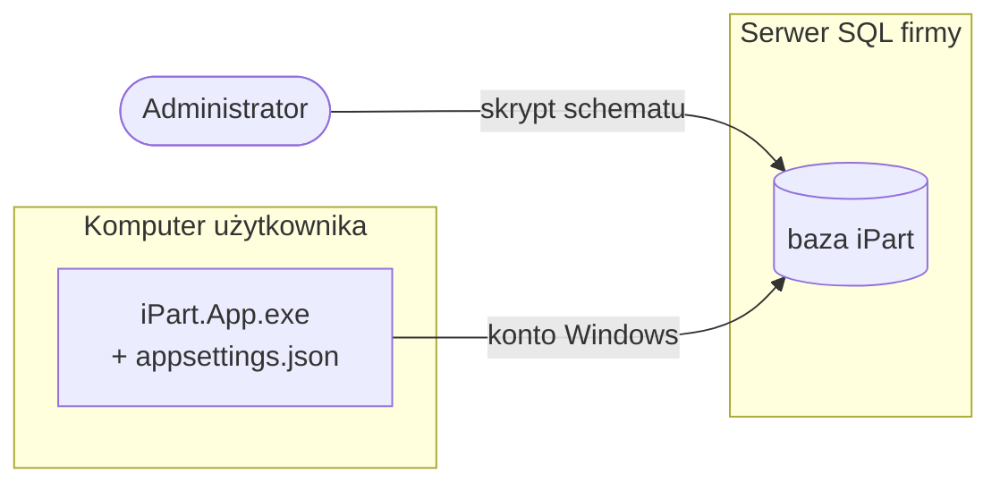

# Środowiska

> **Propozycja.** Opisuje układ środowisk, zasady pracy z bazą i cykl publikacji wersji. Środowisko na serwerze firmy jest dopiero ustalane z IT (sekcja „Stan”).
>
> **Pilotaż** ([ADR-0014](../decyzje/ADR-0014%20Pilotaż%20bez%20serwera%20i%20z%20kopiami%20danych%20ProduMana.md)): program łączy się z bazą testową bezpośrednio, jak w 0.1.0 — opis poniżej obowiązuje do końca pilotażu.
>
> **Do przepisania po [ADR-0010](../decyzje/ADR-0010%20Serwer%20aplikacji%20między%20klientem%20a%20bazą.md):** docelowo aplikacja łączy się z serwerem aplikacji, a nie z bazą. Dostęp do bazy ma tylko konto serwera — opis logowania grupy AD do bazy (zasady 2–3, „Uprawnienia”, „Konfiguracja aplikacji”) dotyczy wersji 0.1.0. Nowy układ: [Architektura techniczna](04%20Architektura%20techniczna.md).

## Środowiska

| | Produkcja | Test | Deweloperskie |
|---|---|---|---|
| Gdzie działa aplikacja | komputery użytkowników, program z udziału sieciowego | do ustalenia | Visual Studio / `dotnet run` na komputerze developera |
| Baza | serwer SQL firmy, nazwa do ustalenia | do ustalenia (wzór ProduMan: kopia produkcji `<Baza>_Test` na tym samym serwerze) | `(localdb)\MSSQLLocalDB`, baza `dataPart` |
| Logowanie do bazy | konto Windows użytkownika przez grupę AD | do ustalenia | konto Windows developera |
| Konfiguracja | `appsettings.json` obok programu | `appsettings.json` obok programu | `src/iPart.App/appsettings.json` |



## Zasady

1. **Jedna baza na środowisko.** Wszyscy użytkownicy pracują na tych samych danych. To realizuje cel „jedno źródło danych pakietu”.
2. **Logowanie kontem Windows**, bez haseł w plikach. Dostęp nadaje się grupie AD, nie pojedynczym osobom.
3. **Użytkownicy czytają i zapisują dane, ale nie zmieniają struktury bazy.** Role SQL `db_datareader` i `db_datawriter`.
4. **Aplikacja nigdy sama nie zmienia struktury bazy.** Schemat wdraża administrator gotowym skryptem SQL ([ADR-0004](../decyzje/ADR-0004%20Schemat%20bazy%20wdraża%20tylko%20administrator.md)).
5. **Najpierw baza, potem aplikacja.** Zmiany schematu planujemy tak, żeby tylko dodawały tabele i kolumny. Wtedy poprzednia wersja aplikacji dalej działa na nowej bazie.
6. **Szyfrowane połączenie z weryfikacją certyfikatu** (`Encrypt=True`, `TrustServerCertificate=False`). `TrustServerCertificate=True` tylko lokalnie albo po świadomej zgodzie IT.
7. **Aplikacja sprawdza zgodność schematu przy połączeniu.** Gdy brakuje tabel tej wersji, zakładki z nich korzystające pokazują komunikat zamiast błędu.

## Baza danych

### Uprawnienia

```sql
-- Grupa Windows z Active Directory (nazwa domeny i grupy — od IT)
CREATE LOGIN [DOMENA\iPart-Uzytkownicy] FROM WINDOWS;

USE [iPart];
CREATE USER [DOMENA\iPart-Uzytkownicy] FOR LOGIN [DOMENA\iPart-Uzytkownicy];
ALTER ROLE db_datareader ADD MEMBER [DOMENA\iPart-Uzytkownicy];
ALTER ROLE db_datawriter ADD MEMBER [DOMENA\iPart-Uzytkownicy];
```

### Wdrożenie schematu

Schemat opisują migracje EF Core w `src/iPart.Infrastructure/Migrations`. Baza pamięta zastosowane migracje w tabeli `__EFMigrationsHistory`.

- **Nowa baza:** [`deploy/sql/iPart-schemat.sql`](../../deploy/sql/iPart-schemat.sql). Tworzy wszystkie tabele i słowniki początkowe.
- **Aktualizacja istniejącej bazy:** skrypt `deploy/sql/aktualizacja-<wersja>-<zmiana>.sql`.
- Skrypty są **idempotentne**: można je uruchomić kilka razy. Administrator uruchamia je w SSMS, z wybraną właściwą bazą (nie `master`).
- Dla osób z SDK .NET alternatywą jest `dotnet ef database update` z parametrem `--connection`. Parametr `-- --settings src/iPart.App/appsettings.json` jest wymagany, bo bez niego narzędzie nie startuje.

## Konfiguracja aplikacji

Plik `appsettings.json` obok programu zawiera connection string w kluczu `ConnectionStrings:IPartDatabase`:

```json
{
  "ConnectionStrings": {
    "IPartDatabase": "Server=SERWER\\INSTANCJA;Database=iPart;Integrated Security=True;Encrypt=True;TrustServerCertificate=False;Connect Timeout=10"
  }
}
```

| Fragment | Znaczenie |
|---|---|
| `Server=SERWER\\INSTANCJA` | adres serwera SQL; w JSON ukośnik wsteczny podwójnie |
| `Database=iPart` | nazwa bazy |
| `Integrated Security=True` | logowanie kontem Windows |
| `Encrypt=True`, `TrustServerCertificate=False` | szyfrowanie z weryfikacją certyfikatu serwera |
| `Connect Timeout=10` | po 10 sekundach aplikacja pokazuje błąd zamiast czekać |

Plik nie zawiera haseł, więc może leżeć na udziale razem z programem. Aplikacja czyta go przy starcie; po zmianie trzeba ją uruchomić ponownie.

- **`appsettings.local.json`** (obok programu, poza repozytorium i poza publikacją) nadpisuje ustawienia na komputerze developera — np. baza LocalDB.
- **Dziennik błędów:** `%LOCALAPPDATA%iPartogsiPart-RRRRMMDD.log` — wersja, Guid konta, treść błędu; bez haseł.
- **Zgodność bazy:** przy starcie program sprawdza, czy baza ma wszystkie zmiany struktury tej wersji; jeśli nie — pokazuje komunikat zamiast wyboru konta.

## Publikacja aplikacji

```powershell
dotnet publish src/iPart.App -p:PublishProfile=Firma
```

- Profil `Firma` (`src/iPart.App/Properties/PublishProfiles/Firma.pubxml`) tworzy folder `publish\iPart\` z wbudowanym .NET (self-contained, win-x64). Na komputerach nie trzeba instalować .NET.
- Każda wersja trafia na udział do **osobnego folderu z numerem wersji**, np. `\\serwer\Aplikacje\iPart\0.1.0\`. Skrót użytkowników przestawia się na nową wersję. Otwartego pliku `.exe` nie da się nadpisać.
- Numer wersji: `<Version>` w `src/iPart.App/iPart.App.csproj`.

### Cykl nowej wersji

1. Zmiana w kodzie i testy (`dotnet test iPart.slnx`).
2. Podniesienie numeru wersji.
3. Przy zmianie modelu danych: nowa migracja i idempotentny skrypt aktualizacji w `deploy/sql/`. Próba generalna: test `PackageDatabaseTests` (zmienna `IPART_RUN_SQL_TESTS=1`) tworzy tymczasową bazę, stosuje wszystkie migracje i ją usuwa.
4. Administrator uruchamia skrypt aktualizacji.
5. Publikacja, nowy folder z numerem wersji, przestawienie skrótu.

## Najczęstsze problemy

| Komunikat | Przyczyna | Co zrobić |
|---|---|---|
| „Brak dostępu do bazy dla Twojego konta Windows” (SQL 18456 / 4060) | konto spoza grupy z dostępem albo brak użytkownika w bazie | IT: dodać do grupy, sprawdzić `CREATE USER` |
| Przekroczono limit czasu połączenia | zła nazwa serwera, zapora, serwer niedostępny | sprawdzić `Server=`, port 1433, VPN |
| Błąd certyfikatu | serwer bez zaufanego certyfikatu | IT: certyfikat |
| „W bazie brakuje tabel tej wersji aplikacji” | nie uruchomiono skryptu schematu lub aktualizacji | administrator: skrypt z `deploy/sql` |
| „Błąd konfiguracji: brak ConnectionStrings…” | zły lub brakujący `appsettings.json` | sprawdzić plik i składnię JSON |

## Stan

2026-11-24: wersja 0.1.0 jest wstępna i służy nauce publikacji z IT, nie pracy produkcyjnej. Brak ról w aplikacji, cen i danych wrażliwych. Import obsługuje tylko `.xlsx`. Działa środowisko deweloperskie (LocalDB `dataPart`). Środowisko na serwerze firmy jest w trakcie ustalania z IT.

## Kierunek

Dziś każdy komputer łączy się bezpośrednio z bazą, a rola `db_datawriter` pozwala zmieniać dane także poza aplikacją. Alternatywą jest usługa API na serwerze, tak jak w ProduMan (pule IIS). Wtedy z bazą łączy się tylko serwer, aktualizacja to jedna instalacja, a uprawnienia (np. ceny tylko dla zakupów) pilnuje serwer. To też ułatwia przyszłe przejęcie przez system magazynowy ([ADR-0001](../decyzje/ADR-0001%20iPart%20jako%20system%20przejściowy%20do%20czasu%20modułu%20BOM.md)).

## Otwarte pytania

| Pytanie | Kto może odpowiedzieć |
|---|---|
| Serwer, instancja i nazwa bazy; wersja SQL Server (wymagana 2016 lub nowsza) | IT |
| Czy serwer ma zaufany certyfikat TLS? | IT |
| Grupa AD dla użytkowników iPart | IT |
| Kopia zapasowa bazy | IT |
| Sposób dystrybucji: udział sieciowy, ClickOnce, Intune/SCCM; podpis kodu | IT |
| Czy iPart ma środowisko testowe na wzór ProduMan? | IT, developer IT |
| Bezpośrednie połączenie z bazą czy usługa API na serwerze? | IT, developer IT |
